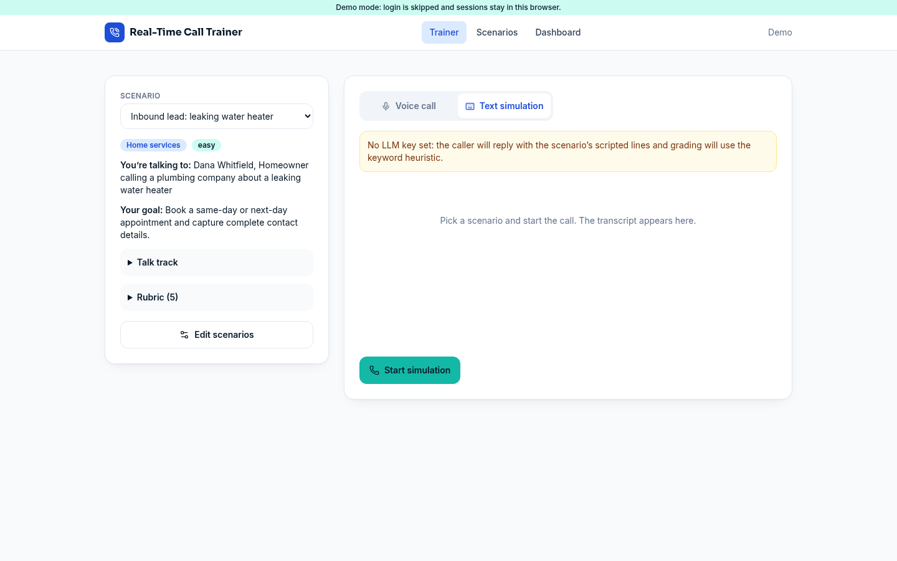

# Real-Time Call Trainer

Practice live sales and service calls against AI personas from 18 sales jobs. A live coach scores every turn and cues you when an objection lands, and the debrief backs every score with quotes from your own transcript.

By Mykel Stanley · MIT licensed



## Features
- **Persona library**: 54 personas across 18 sales job families (SDR cold calls, AE discovery, customer success, insurance, mortgage, real estate, solar, auto, medical devices, B2B procurement, recruiting, collections, financial advising and more), filterable by role, industry, difficulty, objection type and call type. Each persona is a plain pack in `src/lib/personas/`, validated against `ScenarioSchema` on load. Library personas start as **drafts** until a maintainer reviews them; the three original scenarios are marked reviewed.
- **Live coach** (copilot rail): after each turn a separate coach channel returns a live rubric estimate (hatched while provisional, solid once a verbatim quote confirms it), talk-track progress, your talk ratio, and at most one cue (objection, next question, whisper or guardrail) with a suggested line. Objection cues show at once; any other cue that arrives within 8 seconds of the last one is dropped, and the coach doesn't repeat cues it gave recently. *Use line* drops the line into the composer and never sends it, and the persona never sees cues. **Blind** shows no live help, **Guided** shows the estimate and talk track, **Coached** adds cues. Without an LLM key a rules-based coach runs instead.
- **AI persona wizard** (`/library/new`): build a persona, objection bank and rubric from a job description, a product page URL (fetched server-side with SSRF protections), CRM notes, an ideal-customer profile or a pasted call. Every field shows the source it came from; export the result as a pack file for a pull request. Without a key it builds a template draft you can edit.
- **Black-box debrief**: score ring and outcome stamp, a clickable moment strip, criterion evidence that jumps to the transcript line, a grader label naming the model that graded the call (or "rules-based"), a re-grade action, a *Retry from turn N* aimed at your weakest moment, and a next-drill suggestion. See [Grading and re-grades](#grading-and-re-grades).
- **Progress logbook**: KPI sparklines, score trend, practice-day heatmap, skill averages by criterion and a "practise this next" drill.
- **Voice practice** with [OpenAI Realtime](https://platform.openai.com/docs/guides/realtime) (the default whenever an OpenAI key is set, `gpt-realtime-1.5` over WebRTC) or [ElevenLabs Agents](https://elevenlabs.io/docs/agents-platform), or a text simulation that needs no voice keys. A scripted caller and a rules-based coach and grader take over when no LLM key is set.
- **Team view** (`/team`, managers and owners): KPIs, a rep-by-criterion heatmap, a coaching queue, supervisor notes, persona assignments with due dates, and a roster CSV export. Demo mode shows a sample team. See [Team view and assignments](#team-view-and-assignments).
- **Command palette**: Ctrl K (⌘K on macOS) jumps to any page or persona, resumes your last persona and switches the theme.
- **Model settings** (`/settings/models`): which model runs the coach, grading, wizard and text caller, which voice engines are on, and a one-token connection check (`/api/llm/check`). Keys and endpoint URLs are never shown.
- **Graceful degradation**: runs without a voice provider, an LLM key or a database (`DEMO_MODE=true`).
- **Teams and accounts** (optional): Postgres + Prisma, org join codes, TOTP MFA, supervisor notes, training assignments, retention purge job.

## Architecture
```
Browser (Next.js App Router, Tailwind, WebRTC, @elevenlabs/react)
  ├─ /library               persona library (facets, search, pack files)
  ├─ /library/new           AI persona wizard
  ├─ /trainer               pre-call briefing, then the live deck: transcript + copilot rail
  ├─ /trainer/scenarios     persona editor (localStorage)
  ├─ /trainer/debrief/[id]  black-box debrief, retry from turn N
  ├─ /dashboard             progress logbook, assignments for you
  ├─ /team                  team view for managers and owners
  └─ /settings/models, /settings/security
Server routes (src/app/api)
  ├─ coach/turn        live coach: estimate, talk-track steps, one cue (LLM or rules-based)
  ├─ persona/generate  persona wizard (LLM structured JSON, or a template draft)
  ├─ persona/fetch-url SSRF-safe product-page import for the wizard
  ├─ realtime/session  mints a short-lived OpenAI Realtime client secret per call (API key stays server-side)
  ├─ realtime/sdp      relays the browser's WebRTC offer to OpenAI, so the CSP stays same-origin
  ├─ elevenlabs/token  mints a WebRTC conversation token (API key stays server-side)
  ├─ evaluate-call     grades a transcript against the scenario rubric (LLM or heuristic) and seals the grade
  ├─ simulate/turn     text-mode caller (LLM or scripted)
  ├─ transcripts       save / list / fetch sessions (Postgres); POST stores a score only with a valid grade seal, PATCH re-grades
  ├─ sessions/[id]/notes supervisor notes on a saved session; a stale save gets 409
  ├─ team/overview     team KPIs, roster, heatmap and coaching queue (org-scoped)
  ├─ team/assignments  create, list and remove persona assignments
  ├─ llm/check         one-token connection check for the Models page
  └─ auth/*, access, me, health, config, cron/purge-expired
```
Design tokens (daylight, dark and the call "deck") live in `src/app/globals.css`; the coach contract is `src/lib/coach-types.ts`; the wizard contract is `src/lib/wizard-types.ts`.
Scenario definitions and the agent prompt builder are in `src/lib/scenarios.ts`; grading is in `src/lib/grader.ts`, with the grader's caps and the re-grade rule in `src/lib/gradable.ts`.

## Setup
```bash
git clone <your fork> && cd real-time-call-trainer-oss
npm install
cp .env.example .env      # then edit
npm run dev               # http://localhost:3000
```
Quick look without any keys: `DEMO_MODE=true npm run dev`. Demo mode skips login, keeps sessions, assignments and supervisor notes in your browser, and shows a sample team on `/team`. See [TESTING.md](TESTING.md).

### Environment variables
| Variable | Required | Purpose |
|---|---|---|
| `OPENAI_REALTIME_API_KEY` | For voice | OpenAI key for Realtime voice calls. Falls back to `OPENAI_API_KEY`, then to `LLM_API_KEY` when `LLM_BASE_URL` is api.openai.com |
| `OPENAI_API_KEY` | Optional | Voice key when `OPENAI_REALTIME_API_KEY` is unset. Also stands in for `LLM_API_KEY`, but only while `LLM_BASE_URL` is unset or points at api.openai.com, so an OpenAI key is never sent to another provider |
| `REALTIME_MODEL` | Optional | Default `gpt-realtime-1.5` |
| `REALTIME_VOICE` | Optional | Default `marin`. A persona's own `realtimeVoice` wins |
| `REALTIME_TRANSCRIBE_MODEL` | Optional | Transcribes your side of a voice call. Default `gpt-4o-mini-transcribe` |
| `VOICE_ENGINE` | Optional | `openai` (default) or `elevenlabs`: which engine the briefing picks first when both are set up |
| `ELEVENLABS_API_KEY` | For ElevenLabs voice | Server-side key used to mint conversation tokens |
| `ELEVENLABS_AGENT_ID` | For ElevenLabs voice | The agent to call |
| `LLM_API_KEY` | Optional | Live coach, post-call grading, persona wizard and text simulation (any OpenAI-compatible API). With a custom `LLM_BASE_URL`, this is the only key sent. Without a key: rules-based coach and grader, template wizard, scripted caller |
| `LLM_BASE_URL` | Optional | Default `https://api.openai.com/v1` |
| `LLM_MODEL` | Optional | Default `gpt-4.1-mini` |
| `DATABASE_URL` | For accounts | Postgres connection string |
| `JWT_SECRET` | For accounts | 32+ random bytes (`node generate-jwt-secret.js`). Also keys the grade seal and the access-code cookie |
| `CRON_SECRET` | Optional | Bearer secret for `/api/cron/purge-expired`. The route accepts only `Authorization: Bearer $CRON_SECRET` (Vercel Cron sends it when the variable is set) and returns 401 without it |
| `TRAINER_ACCESS_CODE` | Optional | When set, every page and API route (except `/api/health` and `/api/cron/*`, which needs the `CRON_SECRET` bearer) requires this code via `/access`. Cookie is an HMAC keyed by `JWT_SECRET`, valid 30 days. Unset = no gate |
| `TRUSTED_PROXY_HOPS` | Optional | Number of proxies in front of the app that append to `X-Forwarded-For`. The client IP for rate limits and audit rows is read that many entries from the right. Default 1, which fits Vercel and a single proxy that appends. The app needs at least one proxy that sets or appends the header, or clients can pick their own address; see [DEPLOY.md](DEPLOY.md#client-ip-behind-proxies) |
| `RATE_LIMIT_CALLER_MAX` / `_WINDOW_SEC` | Optional | Per-IP limit on `/api/simulate/turn`. Default 30 per 300 s |
| `RATE_LIMIT_GRADING_MAX` / `_WINDOW_SEC` | Optional | Per-IP limit shared by `/api/evaluate-call` and re-grades (`PATCH /api/transcripts/[id]`). Default 10 per 3600 s |
| `RATE_LIMIT_TOKEN_MAX` / `_WINDOW_SEC` | Optional | Per-IP limit on `/api/elevenlabs/token`. Default 10 per 3600 s |
| `RATE_LIMIT_REALTIME_MAX` / `_WINDOW_SEC` | Optional | Per-IP limit on `/api/realtime/session` (one per voice call). Default 10 per 3600 s |
| `RATE_LIMIT_COACH_MAX` / `_WINDOW_SEC` | Optional | Per-IP limit on `/api/coach/turn`. Default 120 per 600 s |
| `RATE_LIMIT_WIZARD_MAX` / `_WINDOW_SEC` | Optional | Per-IP limit shared by `/api/persona/generate` and `/api/persona/fetch-url`. Default 20 per 3600 s |
| `DEMO_MODE` | Optional | `true` skips login; sessions, assignments and notes stay in the browser and `/team` shows a sample team. Never on a public deployment. With `NODE_ENV=production` it is ignored (login stays required, the app refuses to boot, `/api/health` returns 503) unless `ALLOW_PUBLIC_DEMO=true` |
| `ALLOW_PUBLIC_DEMO` | Optional | `true` lets `DEMO_MODE=true` take effect in production, for a deliberate public demo only. Any other value keeps the production guard on |
| `ADMIN_EMAIL`, `ADMIN_PASSWORD` | Optional | Used by `npm run db:seed` to create a platform admin. `ADMIN_FIRST_NAME` and `ADMIN_LAST_NAME` set its name (default Platform Admin) |

### Voice engines
OpenAI Realtime is used whenever an OpenAI key is available. The server mints a 10-minute client secret per call and relays the WebRTC offer through `/api/realtime/sdp`, so the browser never sees your key and the page only connects to its own origin. When ElevenLabs is also set up, the briefing lets each trainee choose, and `VOICE_ENGINE` sets which one is picked first. With neither, calls run in text, which needs no voice keys.

### ElevenLabs agent setup
1. In ElevenLabs, create an agent (Agents Platform → Create agent). Any placeholder system prompt and first message will do; they are overridden per call.
2. Open the agent's **Security** tab and enable overrides for **System prompt**, **First message** and **Voice** (the app sends the prompt and first message on every call, and the voice when a persona sets `voiceId`).
3. Copy the agent id into `ELEVENLABS_AGENT_ID`, and create an API key (with Agents access) for `ELEVENLABS_API_KEY`.
4. If the agent requires authentication (recommended), the app uses a server-minted token, so nothing public is exposed.
5. Optional: set a `voiceId` per scenario in the editor.

### Grading and re-grades
- `/api/evaluate-call` grades the transcript against the persona's rubric with `LLM_MODEL`. Without a key, or when the model call fails, a rules-based grader scores rubric coverage and the debrief marks it "Estimate. Rules-based grade, not AI-graded."
- The debrief shows which model graded the call (the model stored with the grade, not today's setting), the grader version and when. Evidence quotes are checked against the transcript, and quotes that aren't in it are dropped.
- **Grade seal**: every grade comes back with an HMAC seal keyed by `JWT_SECRET` over the user, persona, transcript and evaluation. `POST /api/transcripts` stores a score only when the seal checks out, so a client can't save a score it made up; anything else is saved ungraded. Team KPIs and assignment completion read only these stored scores, and only for library personas: a custom persona's rubric comes from the rep's own browser, so those calls count as practice on the team view but their scores stay personal, and assignments accept library personas only.
- **Long calls**: the grader reads the first 1,000 turns and 120,000 characters. A longer call is graded on that opening part, and the debrief says how many turns were graded.
- **Re-grade** (server sessions, needs an LLM key): managers and owners of the session's organization, and platform admins, can re-grade any call on a library persona. Custom personas live only in the browser that made them, so a call on one can be re-graded only from a browser that holds that persona; anywhere else the button is hidden, and a direct request gets 400 `scenario_required`. The trainee can re-grade only while the call has no AI grade; after that the server answers 403 `regrade_not_allowed` and the debrief says to ask a manager. A failed model call never replaces the stored grade, and library personas are always graded on the server's own copy of the rubric. Browser sessions in demo mode re-grade a rules-based grade only.

### Team view and assignments
`/team` is for managers and owners (and platform admins), and shows only their own organization. Roles are `trainee`, `manager` and `owner`; a trainee who opens `/team` is told it is for managers and owners, and sees only their own assignments. Managers assign a persona to a rep or the whole team with an optional due date, and reps see it under **Assigned to you** on `/dashboard`. An assignment counts as done once the rep has a graded session on that persona made after it was assigned.

Supervisor notes are written from the coaching queue, and the rep sees them on their debrief. If someone else saved the note after you opened it, the save is refused with 409 `conflict` and the editor asks you to open the note again, so one manager can't silently overwrite another.

Demo mode shows a sample team and keeps assignments and notes in your browser. With a database, run the `20261027000000_training_assignments` migration.

### Database
```bash
createdb call_trainer
# set DATABASE_URL, JWT_SECRET in .env
npm run db:migrate        # prisma migrate deploy
npm run db:seed           # optional platform admin
```
Run `npm run db:migrate` again after pulling changes that add a migration. The team view needs `20261027000000_training_assignments`.

### Scripts
| Script | What it does |
|---|---|
| `npm run dev` | Dev server |
| `npm run build` | `prisma generate` + production build |
| `npm start` | Serve the production build |
| `npm run lint` | ESLint |
| `npm run typecheck` | TypeScript, no emit |
| `npm test` | Vitest (`tests/*.test.ts`) |
| `npm run validate:personas` | Checks every persona pack against the schema and the coach |
| `npm run db:migrate` / `db:seed` | Apply migrations / seed admin |

### Tests and CI
- `npm test` runs 750+ Vitest tests in `tests/`: the coach, grader, grade seal, re-grade and notes routes, rate limits, the SSRF guard, persona packs, team logic and more. They need no keys, network or database.
- CI ([`.github/workflows/ci.yml`](.github/workflows/ci.yml)) runs lint, typecheck, test, validate:personas and build on every pull request and every push to `main`, with a read-only token and no secrets.
- The optional Codex review ([`.github/workflows/codex-review.yml`](.github/workflows/codex-review.yml)) comments on pull requests from branches in this repository once a maintainer adds an `OPENAI_API_KEY` Actions secret. Without it the review is skipped. It is advice, not a gate.
- Dependabot ([`.github/dependabot.yml`](.github/dependabot.yml)) opens weekly updates for npm packages and for the SHA-pinned GitHub Actions. See [CONTRIBUTING.md](CONTRIBUTING.md#dependencies-and-pinned-actions).

## Deployment
See [DEPLOY.md](DEPLOY.md).

## Contributing
See [CONTRIBUTING.md](CONTRIBUTING.md).

## Code of Conduct
This project follows the Contributor Covenant. See [CODE_OF_CONDUCT.md](CODE_OF_CONDUCT.md).

## Credits
Originally based on OpenAI's openai-realtime-agents demo (MIT). See [LICENSE](LICENSE).

> **Rate limits:** counters are in-memory (fixed window) and per server instance. On Vercel/serverless they are best-effort: each warm instance counts separately and cold starts reset them. Use a shared store (e.g. Upstash Redis) for strict enforcement. The `RATE_LIMIT_*` variables tune the per-IP limits, and `TRUSTED_PROXY_HOPS` sets where the client IP is read. Most routes also have a fixed per-account limit, so switching networks doesn't get around them: for example the wizard 20 per hour, re-grades 5 per 10 minutes, the Models check 20 per hour and new voice sessions 6 per minute. [TESTING.md](TESTING.md#rate-limits) lists every limit. Request bodies are capped at 200 KB. The live coach reads the most recent turns of a long call, the text caller accepts up to 200 turns and 20,000 characters, and grading reads the first 1,000 turns and 120,000 characters (the debrief says when a call was longer). `/api/access` attempts are limited to 10 per 15 min per IP.
